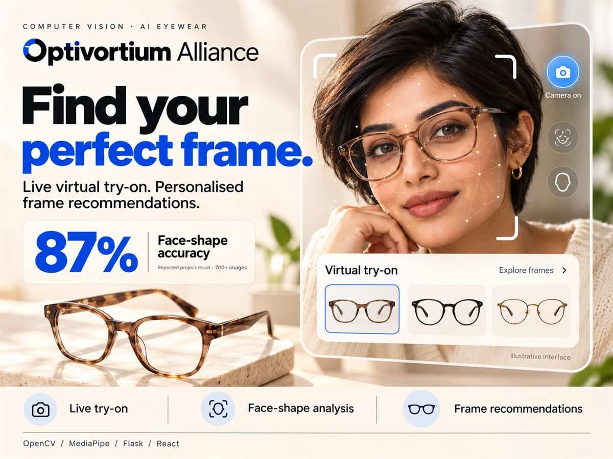
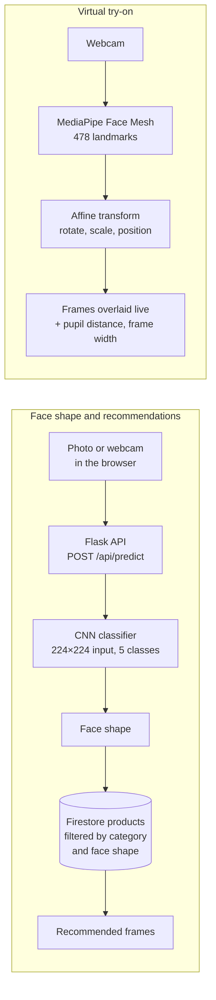
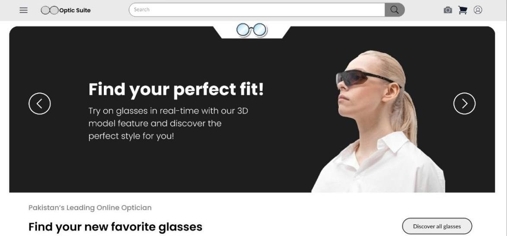

# Optivortium Alliance: AI Eyewear Platform



My final-year project for a BS in Software Engineering at The University of Faisalabad (2026). **Optic Suite** is an online eyewear store that detects your face shape, recommends glasses that suit it, and lets you try frames on live through your webcam.

**87% face shape accuracy on 700+ test images · over 95% face tracking accuracy in testing**

## What it does

- **Real-time virtual try-on (AR).** Overlays eyeglass frames on a live webcam feed using MediaPipe's 478-point facial landmark model, iris points included. An affine transformation (rotation, scale and position) keeps the frames on the face across different head poses. It also measures pupil distance and estimates the frame width in millimetres.
- **Face shape classifier.** Classifies a face as oval, round, square, heart or oblong with 87% accuracy on 700+ test images, served through a Flask REST API (`POST /api/predict`). It accepts an uploaded photo or a webcam capture.
- **Personalised recommendations.** The API reads products for the chosen category (men, women or kids) from Firestore and returns the glasses tagged as suiting the detected face shape.
- **Online shop.** Product pages for men, women and kids, lens and prescription choices, cart and checkout, Firebase sign-in (email, Google and Facebook), and an admin dashboard for adding products.

## How it works



## The model

| File | What it does |
| --- | --- |
| `model/face_shape_classifier.py` | Transfer learning on **MobileNetV2** (ImageNet weights, frozen base) with a small dense head. Uses data augmentation (rotation, shifts, zoom, flips, brightness), balanced class weights, and a classification report and confusion matrix on the validation split. Also predicts a single image. |
| `train_model.py` | A simpler three-block CNN baseline. |
| `script.py` | Builds the dataset by collecting images for each face shape. |
| `model/clean_dataset.py` | Removes corrupted images before training. |

The trained model is about 267 MB, which is over GitHub's file size limit, so it isn't in this repo. Train your own with the scripts above.

## Project structure

```
app.py                  Flask API: face shape prediction and product recommendations
model/                  Classifier training, prediction and dataset clean-up
templates/              Flask page and the face shape client script
website/
  mainpage/             Landing page
  loginpages/           Sign-up and sign-in (email, Google, Facebook)
  Shop/                 Catalogue, product pages, lens choice, checkout, admin dashboard
  VirtualTry-on/        Live try-on with MediaPipe Face Mesh
  ResetPassword/        Password reset
```

## Screenshots



## Run it locally

1. Install the dependencies: `pip install -r requirements.txt`
2. Create a Firebase project and download a service account key as `serviceAccountKey.json` in the project root. It is git-ignored.
3. In Firestore, add a `products` collection. Each product needs a `category` field (`men`, `women` or `kids`) and a `recommendedFor` field listing the face shapes it suits.
4. Put your Firebase web settings in the website files. Search for `YOUR_FIREBASE_` to find every place.
5. Train a model from the project root: `python model/face_shape_classifier.py --train dataset`. Use one folder per face shape inside `dataset`.
6. Start the server with `python app.py` and open http://127.0.0.1:5000.

## Not included

The trained model files, the product and marketing images, photos uploaded by users, and all Firebase keys.

## Tech stack

Python · TensorFlow / Keras · scikit-learn · OpenCV · MediaPipe · Dlib · Flask · Firebase Authentication and Firestore · JavaScript · HTML · Tailwind CSS
